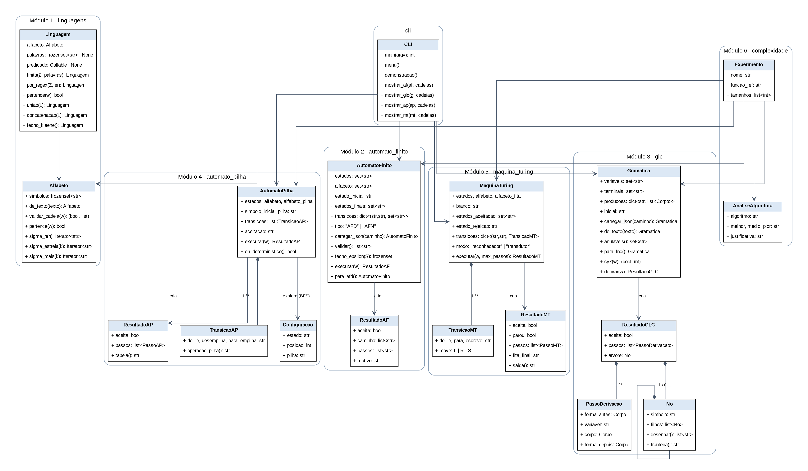
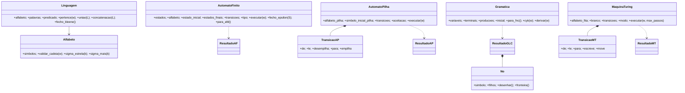
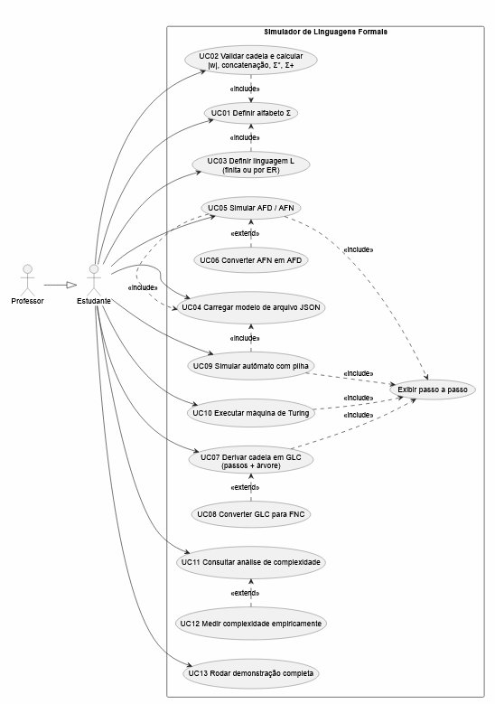
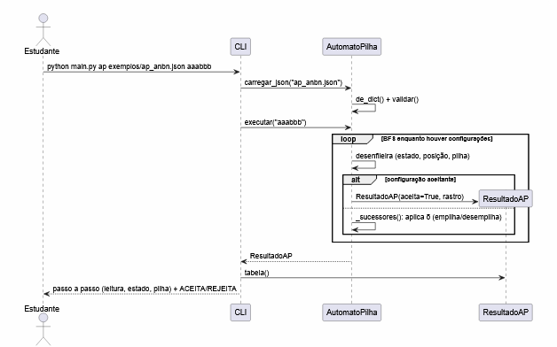

# Documento Técnico: Simulador de Linguagens Formais e Modelos Computacionais

**Universidade de Fortaleza (UNIFOR)**, Centro de Ciências Tecnológicas
**Curso:** Ciência da Computação
**Disciplina:** Aspectos Teóricos da Computação (T291, turma 9)
**Professor:** Ildo Ramos Vieira
**Avaliação:** AV3, projeto prático em dupla
**Alunos:** _Enzo Esmeraldo (2516948)_ e _Lucas Braide (2526367)_
**Repositório:** https://github.com/ensinho/simulador-linguagens
**Data:** novembro de 2026

---

## Sumário
1. Introdução
2. Fundamentação teórica
3. Arquitetura
4. Implementação
5. Análise de complexidade
6. Testes e validação
7. Conclusão
8. Referências

---

## 1. Introdução

### 1.1 Problema

Os modelos da Teoria da Computação (autômatos finitos, gramáticas, autômatos com pilha e máquinas de
Turing) costumam ser estudados no papel, com diagramas e tabelas de transição. Quando o estudante
desenha um autômato, ele não tem como saber se o desenho reconhece mesmo a linguagem pretendida, e é
cansativo simular à mão uma máquina de Turing por dezenas de passos. O cenário do projeto é o de uma
empresa de tecnologia educacional que quer uma ferramenta em que o usuário informa uma cadeia e
**visualiza o processamento** feito por cada modelo.

### 1.2 Objetivos

**Objetivo geral:** desenvolver uma aplicação capaz de modelar, validar e simular linguagens formais,
AFD, AFN, autômatos com pilha, gramáticas livres de contexto e máquinas de Turing, e analisar a
complexidade dos algoritmos implementados.

**Objetivos específicos:**
- Representar alfabetos, cadeias e linguagens e calcular Σ\*, Σ⁺, |w| e concatenação (Módulo 1).
- Carregar autômatos finitos de arquivos JSON e mostrar a execução passo a passo, incluindo AFN com
  transições ε e a conversão AFN → AFD (Módulo 2).
- Mostrar a derivação passo a passo e a árvore de derivação de uma cadeia em uma GLC (Módulo 3).
- Simular autômatos com pilha exibindo leitura, estado e pilha a cada passo (Módulo 4).
- Implementar máquinas de Turing para as duas opções do enunciado: reconhecer {w#w} e somar números
  em unário (Módulo 5).
- Determinar melhor, médio e pior caso de cada algoritmo com O, Ω e Θ e confirmar os resultados
  experimentalmente (Módulo 6).

O projeto também se liga ao objetivo da Unidade II do plano de ensino: *"elaborar simuladores que
implementam modelos formais, com a capacidade de processamento efetivo das instruções textuais que
representam algoritmos"*. No nosso caso, as instruções textuais são os arquivos JSON que descrevem
cada máquina.

---

## 2. Fundamentação teórica

### 2.1 Linguagens formais

Um **alfabeto** Σ é um conjunto finito e não vazio de **símbolos**. Uma **cadeia** (ou palavra) sobre Σ
é uma sequência finita de símbolos de Σ; a cadeia vazia é denotada por ε (ou λ) e |ε| = 0. O
**tamanho** |w| é o número de símbolos de w. A **concatenação** u·v justapõe as cadeias, é
associativa, tem ε como elemento neutro e satisfaz |uv| = |u| + |v|.

- Σⁿ é o conjunto das cadeias de tamanho n, com |Σⁿ| = |Σ|ⁿ.
- **Σ\*** = Σ⁰ ∪ Σ¹ ∪ Σ² ∪ … é o fecho de Kleene, o conjunto de todas as cadeias, incluindo ε.
- **Σ⁺** = Σ\* − {ε} é o fecho positivo.
- Uma **linguagem** L sobre Σ é qualquer subconjunto L ⊆ Σ\*.

Σ\* é infinito, mas **enumerável**: dá para listar suas cadeias em ordem canônica (primeiro por
tamanho, depois lexicográfica). É isso que o simulador faz para "calcular" Σ\* e Σ⁺ até um tamanho
k. Linguagens também podem ser combinadas por união, concatenação (L₁L₂ = {uv | u ∈ L₁, v ∈ L₂}) e
fecho de Kleene (L\*).

### 2.2 Autômatos

**Autômato finito determinístico (AFD).** É a 5-upla M = (Q, Σ, δ, q₀, F), com δ: Q × Σ → Q. A
máquina lê a cadeia da esquerda para a direita, sem memória além do estado atual, e aceita se termina
em um estado de F. As linguagens reconhecidas por AFDs são as **linguagens regulares**.

**Autômato finito não determinístico (AFN / AFN-ε).** Tem δ: Q × Σ_ε → P(Q): de um estado podem sair
zero, uma ou várias transições pelo mesmo símbolo, além de transições ε, que não consomem entrada. O
AFN aceita se **algum** ramo da computação termina em estado final. O **fecho-ε** E(S) é o conjunto de
estados alcançáveis a partir de S só por transições ε. Pela **construção de subconjuntos** (Rabin e
Scott), todo AFN tem um AFD equivalente, então os dois modelos têm o mesmo poder computacional. O custo
é que o AFD pode precisar de até 2^|Q| estados.

**Autômato com pilha (AP).** P = (Q, Σ, Γ, δ, q₀, Z₀, F), com δ: Q × Σ_ε × Γ_ε → P(Q × Γ\*). A pilha
dá ao autômato uma memória ilimitada, porém de acesso restrito: só o topo pode ser lido. Com ela o AP
consegue "contar" e reconhecer linguagens como {aⁿbⁿ | n ≥ 1}, que não é regular (lema do
bombeamento). Os APs **não determinísticos** reconhecem exatamente as linguagens livres de contexto.
Os determinísticos são estritamente mais fracos: {wwᴿ} precisa de não determinismo para "adivinhar"
onde fica o meio da cadeia.

### 2.3 Gramáticas

Uma gramática é G = (V, Σ, R, S). Na **hierarquia de Chomsky**, as gramáticas regulares (tipo 3)
geram as linguagens dos autômatos finitos; as **livres de contexto** (tipo 2), cujas regras têm a forma
A → α com A ∈ V, geram as linguagens dos APs; as sensíveis ao contexto (tipo 1) correspondem aos
autômatos linearmente limitados; e as irrestritas (tipo 0), às máquinas de Turing.

Uma **derivação** S ⇒ α₁ ⇒ … ⇒ w aplica uma regra por passo. Na **derivação mais à esquerda** sempre
se substitui a variável mais à esquerda. Toda derivação corresponde a uma **árvore de derivação**
(raiz S, nós internos são variáveis, folhas lidas da esquerda para a direita formam w). Uma gramática
é **ambígua** se alguma cadeia tem duas árvores diferentes, como em S → SS | (S) | λ.

Na **Forma Normal de Chomsky (FNC)** toda regra é A → BC ou A → a (e opcionalmente S₀ → λ). Toda GLC
pode ser convertida para FNC, e nessa forma qualquer derivação de w (|w| = n ≥ 1) tem exatamente
2n − 1 passos. Essa propriedade é a base do algoritmo **CYK**, que decide w ∈ L(G) em tempo polinomial.

### 2.4 Máquinas de Turing

M = (Q, Σ, Γ, δ, q₀, q_aceita, q_rejeita), com δ: Q × Γ → Q × Γ × {L, R}. Diferente dos modelos
anteriores, a MT tem uma **fita ilimitada de leitura e escrita** e um cabeçote que anda nos dois
sentidos. Uma MT pode **aceitar**, **rejeitar** ou **não parar**.

A **tese de Church-Turing** afirma que tudo o que é computável por um algoritmo é computável por uma
MT. Ao mesmo tempo, existem problemas que nenhuma MT resolve: o **problema da parada** ("dada M e w, M
para com w?") é indecidível. Na prática, isso obriga o nosso simulador a usar um **limite de passos**.
Quando o limite é atingido, ele informa que a máquina não parou dentro do limite, e não que ela entrou
em laço, porque não existe algoritmo geral capaz de decidir isso.

Uma MT pode ser usada como **reconhecedora** (opção A, L = {w#w}, linguagem que não é livre de
contexto) ou como **transdutora**, que calcula uma função (opção B, soma unária 0ᵃ10ᵇ ↦ 0ᵃ⁺ᵇ).

---

## 3. Arquitetura

### 3.1 Visão geral

O núcleo foi escrito em **Python 3**, sem nenhuma dependência externa: a versão de console roda com
`python main.py` em qualquer máquina. A arquitetura separa o **núcleo** (um módulo por modelo
computacional, sem nenhuma entrada ou saída de terminal) das **interfaces**. O mesmo núcleo atende a
duas delas:

- **Console** (`cli.py`): menu interativo e comandos diretos, cobrindo os seis módulos;
- **Interface gráfica** (bônus): uma aplicação **React + TypeScript** (pasta `web/`, construída com
  Vite) que desenha o grafo de estados, a pilha do AP e a fita da MT, com controles para avançar e
  voltar passo a passo e reprodução automática. Ela conversa com `api.py`, um servidor HTTP feito só com a biblioteca padrão
  do Python, que chama os simuladores reais e devolve cada passo em JSON
  (`/api/simular/af`, `/api/simular/ap`, `/api/simular/mt`).

Os testes automatizados usam o mesmo núcleo. Como a interface gráfica não reimplementa nenhum
algoritmo, ela e o console sempre dão a mesma resposta.

```
main.py ──► simulador/cli.py ──┬──► linguagens.py        (Módulo 1)
                               ├──► automato_finito.py   (Módulo 2)
                               ├──► glc.py               (Módulo 3)
                               ├──► automato_pilha.py    (Módulo 4)
                               ├──► maquina_turing.py    (Módulo 5)
                               └──► complexidade.py      (Módulo 6) ──► usa os módulos 2 a 5
web/ (React) ──HTTP/JSON──► api.py ──► automato_finito.py, automato_pilha.py, maquina_turing.py
exemplos/*.json  ──(carregar_json)──► modelos
tests/           ──► núcleo + cli
```

Decisões de projeto:
1. **Modelos descritos em JSON.** O enunciado pede "carregar um autômato por JSON". Estendemos a ideia
   a todos os modelos, de modo que criar uma máquina nova não exige programar.
2. **Validação formal na carga.** Cada `de_dict()` confere a definição formal (estado inicial ∈ Q,
   F ⊆ Q, símbolos ∈ Σ, determinismo no AFD, Σ ⊆ Γ na MT…) e lista todos os erros encontrados.
3. **Resultado separado da execução.** `executar(w)` devolve um objeto `Resultado*` com o veredito, o
   rastro passo a passo, o motivo e um contador de operações, usado no Módulo 6.

### 3.2 Diagrama UML de classes



*Figura 1: Diagrama de classes (fonte: `docs/uml/diagrama_classes.puml`).*

Versão resumida, renderizada pelo próprio GitHub:



### 3.3 Casos de uso



*Figura 2: Diagrama de casos de uso (fonte: `docs/uml/casos_de_uso.puml`).*

O ator principal é o **Estudante**; o **Professor** herda os mesmos casos de uso (usa a ferramenta em sala).
A Figura 3 mostra a interação entre os objetos ao simular uma cadeia no autômato com pilha.



*Figura 3: Diagrama de sequência da simulação no AP (fonte: `docs/uml/sequencia_execucao.puml`).*

| ID | Caso de uso | Fluxo principal | Módulo |
|---|---|---|---|
| UC01 | Definir alfabeto Σ | Usuário digita "a,b"; o sistema valida (não vazio, 1 caractere por símbolo, sem ε) | 1 |
| UC02 | Validar cadeia e calcular \|w\|, concatenação, Σ\*, Σ⁺ | Informa w; o sistema diz se w ∈ Σ\* (apontando o símbolo e a posição inválidos), \|w\|, wᴿ, u·v e enumera Σ\*/Σ⁺ até k | 1 |
| UC03 | Definir linguagem L | L finita ({ab, ba}) ou por expressão regular; testa w ∈ L e lista as palavras até tamanho k | 1 |
| UC04 | Carregar modelo de arquivo JSON | Escolhe um exemplo ou caminho; o sistema valida a definição formal e mostra a tabela de transições | 2–5 |
| UC05 | Simular AFD/AFN | Informa w; o sistema mostra cada transição (ou os conjuntos de estados no AFN) e ACEITA/REJEITA | 2 |
| UC06 | Converter AFN → AFD | (extensão do UC05) mostra o AFD da construção de subconjuntos | 2 |
| UC07 | Derivar cadeia em GLC | O sistema decide por CYK; se aceita, mostra a derivação mais à esquerda e a árvore | 3 |
| UC08 | Converter GLC → FNC | (extensão do UC07) mostra a gramática em Forma Normal de Chomsky | 3 |
| UC09 | Simular AP | Tabela passo a passo: leitura, estado, entrada restante, pilha e operação | 4 |
| UC10 | Executar MT | Fita com o cabeçote marcado a cada passo; veredito (reconhecedor) ou resultado (transdutor) | 5 |
| UC11 | Consultar complexidade | Tabela de melhor, médio e pior caso com justificativa | 6 |
| UC12 | Medir complexidade empiricamente | (extensão do UC11) executa com n crescente e mostra operações/f(n) | 6 |
| UC13 | Demonstração completa | Executa os exemplos do enunciado em sequência (usado na apresentação) | todos |

**Fluxo alternativo comum:** se o JSON tiver erro (estado inexistente, AFD com ε etc.) ou a cadeia
tiver símbolo fora de Σ, o sistema não executa e explica o motivo.

---

## 4. Implementação

### 4.1 Estruturas de dados

| Conceito formal | Estrutura em Python | Por quê |
|---|---|---|
| Alfabeto Σ, conjuntos Q e F | `frozenset` / `set` | Teste de pertinência O(1) amortizado (tabela hash) |
| Cadeia w | `str` | Imutável e indexável em O(1) |
| δ do AFD/AFN | `dict[(estado, símbolo)] → set[estado]` | Consulta δ(q, a) em O(1); a mesma estrutura serve para AFD (conjunto unitário) e AFN; ε é a chave `""` |
| Conjunto de estados ativos do AFN | `frozenset` | Pode ser chave de dicionário, o que é necessário na construção de subconjuntos |
| Produções de uma GLC | `dict[variável → list[tuple[símbolo]]]` | Corpo como tupla (λ = tupla vazia); permite nomes de variáveis com vários caracteres, como S0 e X_a, criados na FNC |
| Forma sentencial | `tuple[str]` | Imutável e "hasheável", então pode ser marcada como visitada na BFS |
| Árvore de derivação | classe `No(simbolo, filhos)` | Árvore n-ária; `fronteira()` concatena as folhas |
| Tabela do CYK | lista `n × (n+1)` de `set` | `tabela[i][l]` = variáveis que geram w[i:i+l] |
| Pilha do AP | `str` com topo em `[0]` | Imutável: duas configurações com a mesma pilha são iguais (permite o conjunto de visitados) |
| Configuração do AP | `Configuracao(estado, posicao, pilha)`, dataclass congelada | Descrição instantânea (q, w restante, γ) usada na BFS |
| Fita da MT | `dict[int → símbolo]` | Fita ilimitada nos dois sentidos sem realocação; célula ausente = branco |
| Fila de exploração | `collections.deque` | `popleft()` em O(1), necessário para a BFS |
| Árvore de busca | `dict filho → (pai, transição)` | Serve ao mesmo tempo como conjunto de visitados e para reconstruir o caminho aceitante |

### 4.2 Algoritmos

**(1) Simulação de AFD** (`AutomatoFinito._executar_afd`)
```
atual ← q0
para cada símbolo a de w:
    se a ∉ Σ: REJEITA
    se δ(atual, a) indefinida: REJEITA (a máquina "trava")
    atual ← δ(atual, a); registra passo
ACEITA se atual ∈ F
```

**(2) Simulação de AFN-ε por conjuntos** (`_executar_afn`). Em vez de explorar cada ramo do não
determinismo com backtracking, que é exponencial, mantemos o **conjunto** de estados em que o AFN pode
estar. É a construção de subconjuntos feita "sob demanda":
```
S ← E({q0})
para cada a em w:  S ← E( ∪_{q ∈ S} δ(q, a) )
ACEITA se S ∩ F ≠ ∅
```
O fecho-ε E(S) é uma busca em profundidade no grafo das transições ε.

**(3) Construção de subconjuntos** (`para_afd`): uma BFS a partir de E({q₀}) que gera somente os
subconjuntos **alcançáveis**. Um subconjunto é final se contém algum estado de F.

**(4) Forma Normal de Chomsky** (`Gramatica.para_fnc`), seguindo o Teorema 2.9 do Sipser:
START (novo S₀ → S), DEL (remove regras λ gerando todas as combinações com e sem as variáveis
anuláveis), UNIT (remove A → B usando o fecho unitário), remoção de símbolos inúteis (não geradores
e inalcançáveis), TERM (X_a → a) e BIN (A → X₁X₂X₃ vira A → X₁A_1, A_1 → X₂X₃).

**(5) CYK** (`Gramatica.cyk`), por programação dinâmica:
```
para i: tabela[i][1] ← { A | A → w[i] }
para l = 2..n (tamanho), i = 0..n−l (início), k = 1..l−1 (corte):
    para cada A → BC: se B ∈ tabela[i][k] e C ∈ tabela[i+k][l−k]: tabela[i][l] ∪= {A}
ACEITA se S0 ∈ tabela[0][n]
```

**(6) Derivação mais à esquerda passo a passo** (`_bfs_mais_a_esquerda`). O enunciado pede a derivação
na gramática original, e não na FNC. Fazemos uma **busca em largura** sobre as formas sentenciais,
sempre expandindo a variável mais à esquerda. Para que a busca seja viável usamos três **podas
seguras**, que nunca descartam uma forma capaz de derivar w:
- (a) os terminais antes da primeira variável têm de ser prefixo de w;
- (b) os terminais depois da última variável têm de ser sufixo de w;
- (c) a soma dos *tamanhos mínimos deriváveis* de cada símbolo (calculados por ponto fixo) não pode
  passar de |w|.

O ponto mais importante: **o CYK decide antes**. A BFS só roda se w ∈ L(G); como existe uma derivação
de tamanho finito e a BFS percorre os níveis em ordem, ela termina. Sem essa decisão prévia, uma
gramática como S → SS | λ faria a busca rodar para sempre em cadeias fora da linguagem. A árvore é
reconstruída repetindo os passos: cada passo expande a folha-variável mais à esquerda.

**(7) Simulação do AP** (`AutomatoPilha.executar`): BFS sobre configurações (estado, posição, pilha).
Para cada configuração, aplicamos toda transição δ(q, a|ε, X|ε) compatível: desempilhamos X e
empilhamos γ. Quando um caminho aceita, ele é reconstruído pelo dicionário de pais. Se a cadeia é
rejeitada, mostramos a computação que **mais avançou**, para explicar onde a máquina travou. Um limite
de altura da pilha (2n + 10 por padrão) e de número de configurações impede laços de transições ε que
só empilham.

**(8) Máquina de Turing** (`MaquinaTuring.executar`):
```
repita até max_passos:
    se estado é de aceitação/rejeição: PARA
    t ← δ(estado, fita[cabeça]);  se indefinida: PARA e REJEITA
    fita[cabeça] ← t.escreve; cabeça ← cabeça ± 1; estado ← t.para
se esgotou: "não parou dentro do limite" (problema da parada)
```
*Opção A (w#w):* a máquina do Sipser (ex. 3.9) risca com x o primeiro símbolo não marcado à esquerda
do #, procura o símbolo correspondente à direita do #, risca também e volta (zigue-zague). Quando
sobram só x à esquerda, confere que só há x à direita.
*Opção B (soma unária):* anda até o separador 1 e o troca por 0 (q0), segue até o fim (q1), volta uma
casa e apaga o último 0 (q2 → qf). Como 0ᵃ10ᵇ tem a+b+1 símbolos, sobram a+b zeros.

---

## 5. Análise de complexidade

Notação: f ∈ **O(g)** se f(n) ≤ c·g(n) a partir de algum n₀ (limite superior); f ∈ **Ω(g)** se
f(n) ≥ c·g(n) (limite inferior); f ∈ **Θ(g)** se ambos valem (limite justo). Em toda a análise,
n = |w|.

### 5.1 Análise teórica

| Algoritmo | Melhor caso | Caso médio | Pior caso | Justificativa |
|---|---|---|---|---|
| Validar w ∈ Σ\* | Θ(1) | Θ(n) | Θ(n) | Para no 1º símbolo inválido; uma cadeia válida exige ler os n símbolos, cada consulta hash O(1) |
| \|w\| e concatenação | Θ(n) | Θ(n) | Θ(n) | Contar/copiar n símbolos (\|uv\| = \|u\|+\|v\|) |
| Enumerar Σ\* até k | Θ(k·\|Σ\|ᵏ) | Θ(k·\|Σ\|ᵏ) | Θ(k·\|Σ\|ᵏ) | Proporcional ao tamanho da saída: Σ_{i≤k}\|Σ\|ⁱ cadeias |
| Simulação de AFD | Θ(1) | Θ(n) | Θ(n) | 1 transição O(1) por símbolo; melhor caso: AFD parcial trava no 1º símbolo. AFD completo: sempre Θ(n) |
| Simulação de AFN-ε | Θ(1) | Θ(n·k) | O(n·\|Q\|²) | Até \|Q\| estados ativos × até \|Q\| destinos por símbolo, mais o fecho-ε; k = média de estados ativos |
| AFN → AFD | Θ(\|Σ\|·\|Q\|) | – | O(2^\|Q\|·\|Σ\|·\|Q\|²) | Até 2^\|Q\| subconjuntos alcançáveis (explosão exponencial) |
| Conversão para FNC | Θ(\|G\|) | O(\|G\|²) | O(2^m·\|G\|²) | UNIT gera O(\|V\|²) regras; DEL gera 2^m variantes de um corpo com m anuláveis |
| **CYK** | Θ(n³·\|R\|) | Θ(n³·\|R\|) | Θ(n³·\|R\|) | Três laços completos (tamanho × início × corte) × regras binárias. Mesmo custo sempre, por isso Θ |
| Derivação (BFS com podas) | Θ(n²) | exponencial | O(bᵈ·n) | b = máx. de regras por variável, d = passos. Em S→aSb\|λ a poda deixa 1 forma viável por nível |
| AP determinístico (aⁿbⁿ) | Θ(1) | Θ(n) | Θ(n) | 1 transição por símbolo + push/pop O(1); exatamente n+2 configurações para aⁿbⁿ |
| AP não determinístico (wwᴿ) | Θ(n) | Θ(n) | Θ(n²) | n+1 "chutes" do meio; no pior caso (aⁿ) cada chute sobrevive min(i, n−i) passos: Σ ≈ n²/4 |
| **MT w#w** | Θ(n) | Θ(n²) em L | Θ(n²) | Cada um dos ≈n/2 símbolos exige ir e voltar ≈n células. Exato para w#w ∈ L: **T(n) = (n+1)²/2** |
| **MT soma unária** | Θ(n) | Θ(n) | Θ(n) | Uma passada à direita + 2 passos: **T(n) = n + 2** em qualquer caso |

**Detalhe da MT w#w.** Seja k = |w| (n = 2k + 1). Para riscar o i-ésimo par, o cabeçote atravessa de
uma ponta à outra do trecho entre os pares, ≈ 2(k + 1) células entre ida e volta. Somando para os k
pares e a verificação final, chegamos a T = 2(k+1)², ou seja, T(n) = (n+1)²/2. Isso dá Θ(n²), e a
medição abaixo confirma a fórmula exatamente (n = 401 → 80 802 passos = 2·201²). No melhor caso a
cadeia diverge já no primeiro par, e basta uma travessia: Θ(n).

**Ligação com P e NP.** Todos os algoritmos de decisão implementados são **polinomiais**, então os
problemas que resolvem estão na classe **P**: pertinência em linguagem regular O(n), em linguagem livre
de contexto O(n³) pelo CYK, e w#w O(n²). Os dois pontos exponenciais (a construção de subconjuntos e a
BFS de derivação) não contradizem isso. No primeiro caso, o custo exponencial está na conversão do
modelo, não na decisão. No segundo, existe um algoritmo polinomial (o CYK) e a BFS serve apenas para
**exibir** uma derivação, não para decidir.

### 5.2 Análise empírica

Cada simulador conta suas operações elementares: transições no AFD, estados ativos visitados no AFN,
células avaliadas no CYK, configurações exploradas no AP e passos da MT. Executamos com n crescente e
calculamos **razão = operações / f(n)**. Se a razão converge para uma constante c, temos evidência
experimental de que o custo é Θ(f(n)). Os dados abaixo saem de `python main.py complexidade --empirico`.

| Experimento | f(n) | n | operações | razão |
|---|---|---|---|---|
| AFD (nº par de a's) | n | 100 / 1 000 / 100 000 | 100 / 1 000 / 100 000 | **1,000** (exata) |
| AFN (termina em ab) | n | 100 / 1 000 / 100 000 | 352 / 3 543 / 350 102 | 3,52 → **3,50** |
| CYK (aⁿbⁿ na FNC) | n³ | 8 / 16 / 32 / 64 | 520 / 4 112 / 32 800 / 262 208 | 1,016 → **1,000** |
| AP determinístico (aⁿbⁿ) | n | 10 / 100 / 1 000 / 5 000 | 12 / 102 / 1 002 / 5 002 | → **1,000** (= n+2) |
| AP não det. (wwᴿ, pior caso aⁿ) | n² | 10 / 40 / 160 | 53 / 503 / 6 803 | 0,53 → **0,27** (→ 1/4) |
| MT w#w (w#w ∈ L) | n² | 11 / 101 / 401 | 72 / 5 202 / 80 802 | 0,595 → **0,502** (→ 1/2) |
| MT soma unária | n | 11 / 101 / 10 001 | 13 / 103 / 10 003 | → **1,000** (= n+2) |

Leitura dos resultados: as razões estabilizam, o que confirma Θ(n) para AFD, AFN, AP determinístico e
soma unária, Θ(n²) para a MT w#w e o pior caso do AP de wwᴿ, e Θ(n³) para o CYK. As constantes
observadas também batem com a análise: 1/2 na MT corresponde a (n+1)²/2, e 1/4 no AP corresponde a
Σ min(i, n−i) ≈ n²/4. No tempo de relógio, o AFD processou 100 000 símbolos em cerca de 36 ms.

---

## 6. Testes e validação

A suíte `tests/test_simulador.py` (33 testes, `python -m unittest -v`, roda em menos de 1 s) cobre os
seis módulos. Além dos exemplos do enunciado, usamos **testes exaustivos contra a definição
matemática**: para todas as cadeias até um tamanho limite, o veredito do simulador é comparado com um
predicado Python que expressa a linguagem diretamente. Alguns exemplos:

| Modelo | Comparado com | Cadeias testadas |
|---|---|---|
| AFD múltiplo de 3 | `int(w, 2) % 3 == 0` | todas de {0,1}\* com \|w\| ≤ 9 (1 023) |
| AFN termina em ab / AFN-ε a\*∪b\* | `w.endswith("ab")` / só a's ou só b's | \|w\| ≤ 7 |
| AFN ≡ AFD convertido | mesma resposta nos dois | \|w\| ≤ 7 |
| GLC aⁿbⁿ, palíndromos, parênteses | predicados equivalentes | \|w\| ≤ 8 |
| AP aⁿbⁿ (n ≥ 1) e AP wwᴿ | `w == a^k b^k`, `w == w[::-1]` | \|w\| ≤ 8 |
| MT w#w | `split("#")` com 2 partes iguais | todas de {0,1,#}\* com \|w\| ≤ 7 (3 280) |
| MT soma unária | a + b, e T(n) = n + 2 | 0 ≤ a, b ≤ 5 |

Também testamos a validação de JSON inválido (AFD com ε, destino inexistente), a aceitação por pilha
vazia, uma MT que nunca para (deve terminar com "NÃO PAROU") e todos os comandos da CLI.

---

## 7. Conclusão

O projeto implementou os seis módulos pedidos: linguagens formais, autômatos finitos (AFD, AFN e
AFN-ε), gramáticas livres de contexto, autômatos com pilha, máquinas de Turing (opções A **e** B) e a
análise de complexidade, tudo com exibição passo a passo e modelos descritos em JSON.

Implementar os modelos deixou mais concretos vários resultados que em sala vimos como teoremas:
- a **equivalência AFN ≡ AFD**, que virou um teste automatizado sobre todas as cadeias até tamanho 7;
- o fato de o **não determinismo** custar caro para simular: o AP de wwᴿ explora Θ(n²) configurações
  no pior caso, contra Θ(n) do AP determinístico de aⁿbⁿ;
- a utilidade prática da **Forma Normal de Chomsky**, sem a qual o CYK não funciona e sem o qual a
  busca de derivações poderia não terminar;
- o **problema da parada** como restrição real de implementação, e não só um resultado teórico:
  sem limite de passos o simulador de MT poderia travar.

Limitações e trabalhos futuros: (i) os símbolos de Σ têm um único caractere; (ii) a derivação passo a
passo é exponencial em gramáticas ambíguas, e poderia ser substituída pelo algoritmo de Earley para
gerar a árvore em O(n³); (iii) não implementamos a minimização de AFD nem a conversão GLC → AP.

---

## 8. Referências

- SIPSER, Michael. *Introdução à teoria da computação*. São Paulo: Cengage Learning, 2007.
- MENEZES, Paulo Blauth. *Linguagens formais e autômatos*. 6. ed. Porto Alegre: Bookman, 2011.
- DIVERIO, Tiarajú Asmuz; MENEZES, Paulo Blauth. *Teoria da computação: máquinas universais e
  computabilidade*. 3. ed. Porto Alegre: Bookman, 2011.
- LEWIS, Harry R.; PAPADIMITRIOU, Christos H. *Elementos de teoria da computação*. 2. ed. Porto Alegre:
  Bookman, 2000.
- TOSCANI, Laira Vieira; VELOSO, Paulo A. S. *Complexidade de algoritmos: análise, projeto e métodos*.
  3. ed. Porto Alegre: Bookman, 2012.
- LOUDEN, Kenneth C. *Compiladores: princípios e práticas*. São Paulo: Pioneira Thomson Learning, 2004.
- HOPCROFT, John E.; MOTWANI, Rajeev; ULLMAN, Jeffrey D. *Introdução à teoria de autômatos,
  linguagens e computação*. Rio de Janeiro: Campus, 2002. (algoritmo CYK)
